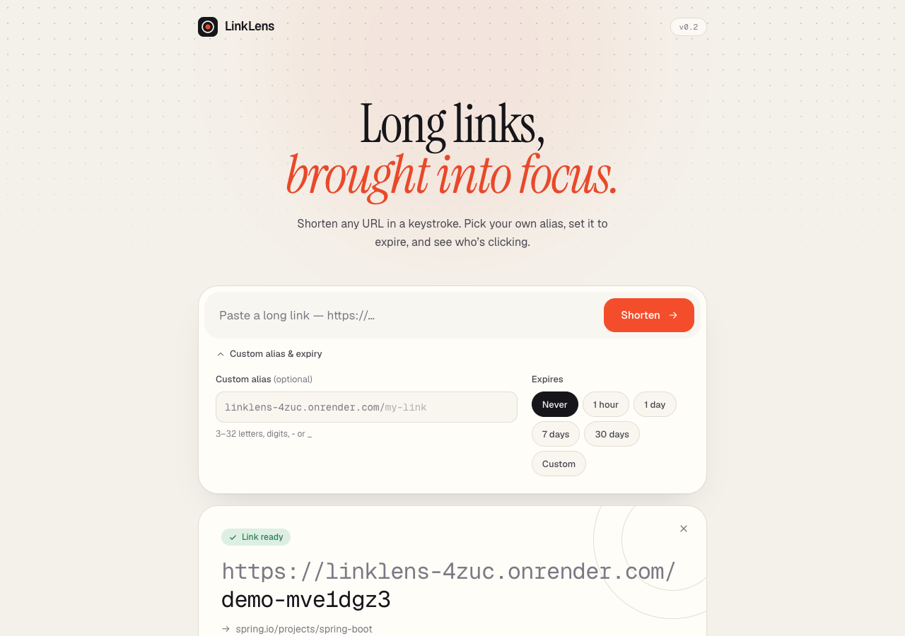
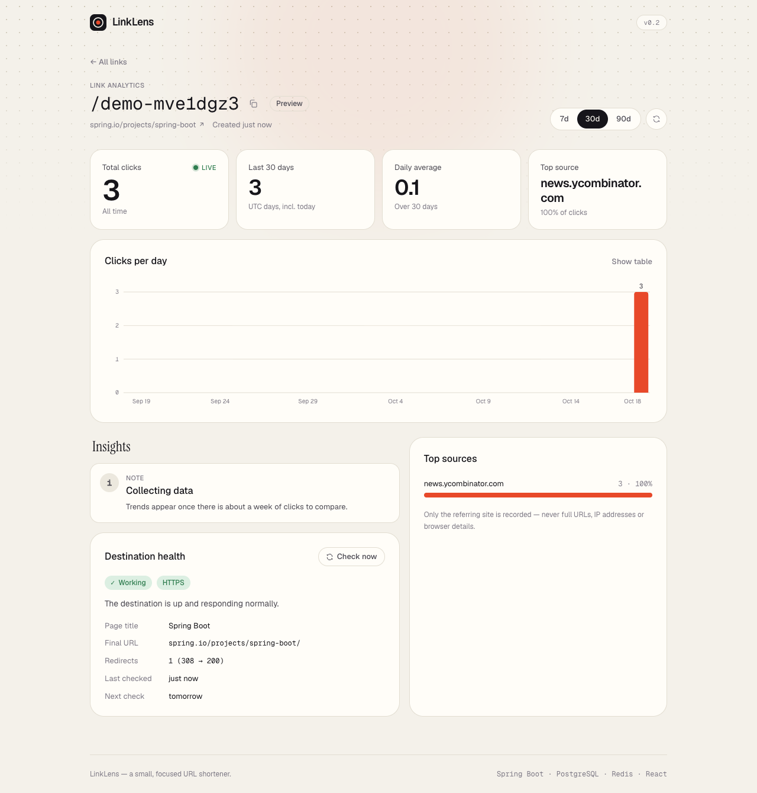
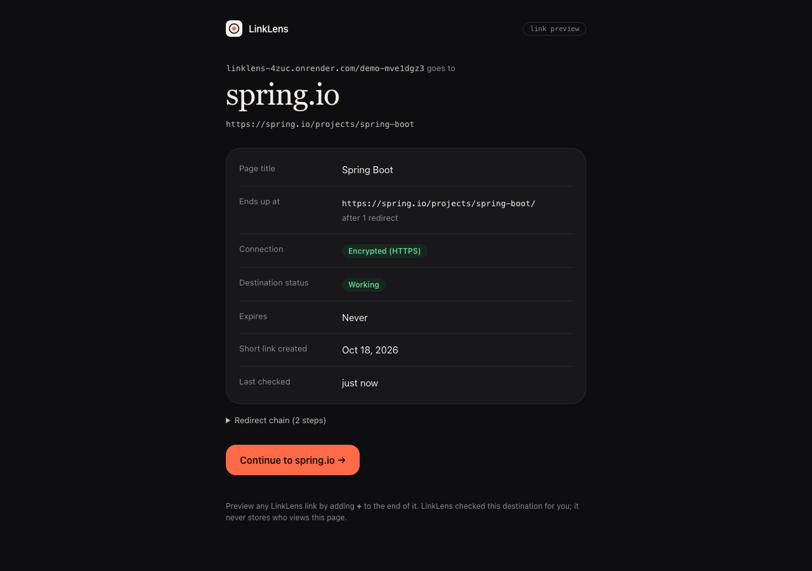
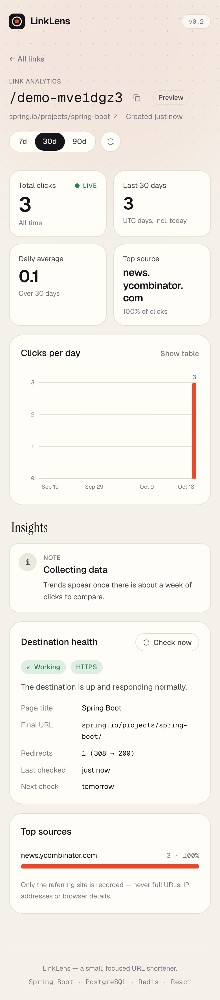

# Deployment

LinkLens runs entirely on free tiers: **Render** (backend, cache, frontend) and **Neon** (PostgreSQL). Free tiers change, so the limits below are the ones verified on **2026-10-18**. Check them again before relying on them.

## Live

| | URL |
|---|---|
| App (UI) | https://linklens-app.onrender.com |
| Short links, preview pages, API | https://linklens-4zuc.onrender.com (e.g. `/{code}`, `/{code}+`) |
| Health | https://linklens-4zuc.onrender.com/actuator/health/readiness |

The backend got the `-4zuc` suffix because `linklens.onrender.com` belongs to another account's (suspended) service.

## Production architecture

```
                     https://linklens-app.onrender.com          (Render Static Site, global CDN)
 Browser ──────────► React SPA ──── fetch / EventSource ──┐
                                                           ▼  CORS: only the app's origin
 Anyone ──► https://linklens-4zuc.onrender.com/{code}  ──► Render edge (TLS) ──► Spring Boot container
            https://linklens-4zuc.onrender.com/{code}+                          (Render Free web service,
            https://linklens-4zuc.onrender.com/api/...                           Docker, Singapore)
                                                                  │                │
                                         private network, no TLS  │                │ TLS (sslmode=require)
                                                                  ▼                ▼
                                              Render Key Value (Redis)      Neon PostgreSQL
                                              free, LRU, no persistence     free, aws-ap-southeast-1
```

- **TLS** terminates at Render's edge (Cloudflare in front of Render), and certificates are automatic. Short links are built from `APP_BASE_URL` (`https://…`). Rate limiting keys on `CF-Connecting-IP`, not `X-Forwarded-For`; see "Fixed during deployment" below.
- **App and database share a region** (Singapore ↔ AWS ap-southeast-1). Every uncached redirect and every write is a database round trip.
- **Migrations:** Flyway runs on startup, before the app accepts traffic. Hibernate is `validate`-only, so a schema/code mismatch fails the deploy instead of corrupting data.
- **Deploys:** push to `main` → GitHub Actions CI. Render builds and deploys **only if the checks pass** (`autoDeployTrigger: checksPass`).

## Providers and why

| Need | Choice | Free-tier facts (verified 2026-10-18) | Rejected |
|---|---|---|---|
| Backend (Docker) | Render Free web service | 512 MB RAM, 0.1 CPU; **sleeps after 15 min without traffic**, ~1 min to wake; 750 instance-hours/month per workspace; managed TLS | Koyeb: no free web service listed on its pricing page any more. Fly.io / Railway: trial credit, not free. |
| PostgreSQL | **Neon Free** | Permanent, no card; 1 GB/project; **100 CU-hours/month**; compute suspends after 5 min idle (always on, can't disable); wakes in ~hundreds of ms | Render Free Postgres: **deleted 30 days after creation** |
| Redis | Render Free Key Value | One per workspace; **no persistence** (data lost on restart); internal network only | Upstash Free (500K commands/month, archived after ≥14 days idle): workable, but every redirect spends quota |
| Frontend | Render Static Site | Free, CDN-served, doesn't sleep | Netlify (credit pool that pauses sites), GitHub Pages (needs a public repo or a paid plan) |

Sources: [Render free docs](https://render.com/docs/free), [Render pricing](https://render.com/pricing), [Neon pricing](https://neon.com/pricing), [Neon scale-to-zero](https://neon.com/docs/introduction/scale-to-zero), [Upstash pricing](https://upstash.com/pricing/redis), [Upstash FAQ](https://upstash.com/docs/redis/help/faq).

**Why a no-persistence Redis is fine here.** Redis is a pure cache in LinkLens. On restart it's empty, the first lookup of each link falls through to PostgreSQL and refills it, and if Redis is down entirely the app fails open (see caching.md). Nothing is lost except a little latency.

### Settings shaped by the free tiers

| Constraint | Setting | Why |
|---|---|---|
| Neon bills compute while awake (100 CU-h ≈ 400 h at 0.25 CU, which is less than a month) | `DB_MIN_IDLE=0`, `DB_IDLE_TIMEOUT_MS=60000`, `DB_MAX_LIFETIME_MS=240000`, `DB_POOL_SIZE=5` | The pool drains to zero connections when idle, so Neon can suspend. Connections are recycled before Neon drops them. |
| Same budget | `HEALTH_POLL_INTERVAL=30m` (default 30 s) | The link-rot scheduler queries the DB on every poll; every 30 s would keep Neon awake 24/7 |
| Same budget | Render health check = `/actuator/health/liveness` | Liveness has no dependencies; readiness (with the DB) is separate. Frequent platform health checks never touch Neon. |
| 512 MB RAM | `MaxRAMPercentage=65`, SerialGC | Measured 202 MB in use under the same limits locally |
| 0.1 CPU | C1-only JIT + **Class Data Sharing** archive built into the image | Measured locally at `--cpus=0.1`: "Started" 133.6 s → 76.8 s; first answered request 145 s → 89 s |

## Screenshots (production)

| Home: live counter on a new link | Analytics + destination health |
|---|---|
|  |  |

| Preview page `/{code}+` (dark) | Analytics on mobile |
|---|---|
|  |  |

## Local setup

```bash
# Data stores only (PostgreSQL on 5433, Redis on 6379), app from your IDE/terminal:
docker compose up -d
cd backend && DB_URL=jdbc:postgresql://localhost:5433/linklens DB_USERNAME=linklens DB_PASSWORD=linklens ./mvnw spring-boot:run

# Everything in containers: UI http://localhost:3000, API + short links http://localhost:8080
docker compose --profile app up -d --build
# Ports busy? BACKEND_PORT=8081 FRONTEND_PORT=3001 REDIS_PORT=6380 docker compose --profile app up -d --build

# End-to-end check (21 checks) against any environment:
scripts/smoke-test.sh http://localhost:8080 http://localhost:3000
```

## Environment variables (production)

Set in `render.yaml`, except the three secrets.

| Variable | Value | Secret? |
|---|---|---|
| `DB_URL` | `jdbc:postgresql://<neon-host>/<db>?sslmode=require` (the **direct** host, not `-pooler`) | yes |
| `DB_USERNAME` / `DB_PASSWORD` | from Neon | yes |
| `REDIS_URL` | injected from the Key Value service (`fromService … connectionString`) | managed by Render |
| `APP_BASE_URL` | `https://linklens-4zuc.onrender.com` | no |
| `CORS_ALLOWED_ORIGINS` | `https://linklens-app.onrender.com` | no |
| `FORWARD_HEADERS_STRATEGY` | `native` | no |
| `CLIENT_IP_HEADER` | `CF-Connecting-IP` (rate-limit key; set by Cloudflare, not spoofable through Render's edge) | no |
| `DB_POOL_SIZE`, `DB_MIN_IDLE`, `DB_IDLE_TIMEOUT_MS`, `DB_MAX_LIFETIME_MS` | `5`, `0`, `60000`, `240000` | no |
| `HEALTH_POLL_INTERVAL` | `30m` | no |
| `LOGGING_STRUCTURED_FORMAT_CONSOLE` | `ecs` (one JSON object per log line) | no |
| `VITE_API_BASE_URL`, `VITE_SHORT_BASE_URL` (static site, build time) | `https://linklens-4zuc.onrender.com` | no |

**Secrets:**
- Never committed: `.env` is git-ignored, and the Blueprint uses `sync: false`, so Render asks for the values once and stores them encrypted.
- Not in GitHub: deploys are triggered by Render watching CI, so no deploy keys live in GitHub Actions.
- Rotating the Neon password means updating `DB_PASSWORD` in Render, which triggers a restart.

## Deploy steps

1. **Neon:** create the project `linklens` in **AWS Asia Pacific (Singapore)**. Under **Connect**, turn connection pooling **off** and note the host, database, user and password.
2. **Render:** sign in with GitHub and allow access to the repo. **New → Blueprint →** select the repo. Render reads `render.yaml`; enter `DB_URL`, `DB_USERNAME` and `DB_PASSWORD`, then **Apply**.
3. Wait for the first deploy. The backend image builds on Render, then Flyway creates the schema on Neon.
4. If Render had to rename a service (the name was taken), update `APP_BASE_URL`, `CORS_ALLOWED_ORIGINS` and the static site's `VITE_*` to the real URLs, and redeploy.
5. **Verify:** `scripts/smoke-test.sh https://linklens-4zuc.onrender.com https://linklens-app.onrender.com`, or GitHub → Actions → **Smoke test** → Run workflow.

## Verification (production, 2026-10-18)

All checks below were run against the live URLs. None are estimates.

| Check | Result |
|---|---|
| `scripts/smoke-test.sh` (22 checks) | **22/22 passed**. Covers liveness/readiness, create (HTTPS short URL), 302 redirect, duplicate alias 409, invalid URL 400, unknown 404, bad period 400, expiring link 302 → 410, analytics + insights, health, preview with CSP, live SSE stream, persistence, CORS, frontend shell and SPA route fallback. |
| UI end to end (headless Chrome) | Created a link in the UI; following it 3× updated the result card's live counter to "3 clicks"; analytics showed `news.ycombinator.com` 100% (host only) and destination health "Working" (title "Spring Boot", 308 → 200). |
| Outbound checks from Render | `example.com` → HEALTHY with title; a link to `169.254.169.254` → **BLOCKED**, never fetched |
| Rate limit vs a spoofed `X-Forwarded-For` | After the fix: remaining 19 → 18 → 17 → 16 across normal and spoofed requests (one bucket per real client) |
| No lost clicks under load | Counter = **1,304** after exactly 1,304 redirects sent (smoke + timing + load tests) |
| Persistence across sleep/wake | ✅ data intact after the instance slept and woke (see "Cold start") |

## Fixed during deployment

1. **Placeholder secret:** the first deploy failed with `UnknownHostException: <host from Neon>`, because `DB_URL` held the template text. Fixed in the Render dashboard.
2. **Service name taken:** `linklens.onrender.com` serves another account's suspended app. Render assigned `linklens-4zuc`, and the frontend's API base and `APP_BASE_URL` were updated in `render.yaml`.
3. **Rate-limit bypass (security):** behind Render's Cloudflare edge, a client-supplied `X-Forwarded-For` was passed through, so a spoofed header gave a fresh token bucket. The limiter now keys on `CF-Connecting-IP` (`CLIENT_IP_HEADER`). Re-verified live.
4. **Timestamp precision (found by CI on Linux):** nanosecond `Instant.now()` versus PostgreSQL's microseconds meant API timestamps changed between create and read. The app clock now ticks in microseconds.
5. **`/favicon.ico` 404s** on every preview view (the browser asked the short-link domain). The icon is now inlined.

## Performance (production)

Measured from India (Delhi Cloudflare edge → Render Singapore) with ApacheBench over HTTPS + keep-alive, one load generator, after a 50-request warmup. Kept deliberately small: it's a shared free tier.

| Scenario | concurrency | requests | req/s | mean ms | p50 | p90 | p99 | max | errors |
|---|---|---|---|---|---|---|---|---|---|
| redirect (302) | 1 | 200 | 11 | 93.2 | 90 | 101 | 132 | 171 | 0 |
| redirect (302) | 8 | 1,000 | **37** | 217.6 | 197 | 380 | 806 | 1,698 | 0 |
| unknown code (404) | 8 | 500 | 45 | 177.0 | 150 | 205 | 303 | 3,128 | 0 |
| analytics, 30 days (200) | 4 | 200 | 19 | 208.9 | 158 | 209 | 1,106 | 3,165 | 0 |
| preview page (200) | 4 | 200 | 23 | 171.3 | 136 | 151 | 2,182 | 3,149 | 0 |

Single requests (average of 3): a liveness probe took 0.124 s and a redirect 0.125 s end to end; TLS took ~0.024 s with a reused connection.

How to read these numbers:
- **Network dominates single requests.** A no-op liveness check costs the same as a redirect, so server time is a few ms out of ~120.
- **0.1 CPU is the throughput ceiling.** About 37–45 req/s means roughly 2–3 ms of CPU per request, which saturates a tenth of a core. Locally the same code serves 82k redirects/s (performance.md); the difference is the instance size, not the design.
- **Tail latency** (p99 ~1–2 s, max ~3 s) comes from CPU throttling on the shared instance and sometimes from Neon waking up.

## Cold start

Measured on 2026-10-18 after the backend had received no traffic for about 30 minutes (Render spins free instances down after 15):

| Measurement | Result |
|---|---|
| First request after idle (a redirect) | **77.7 s**: Render waking the instance, then the JVM starting on 0.1 CPU |
| Next three requests | 0.28–0.30 s each |
| Data after the sleep/wake cycle | Demo link: 7 clicks (3 from the UI test + 4 from this probe) and still HEALTHY; load-test link: still 1,304 clicks; expired link: still 410 |

So data persists across restarts (it lives in Neon, not in the container). A cold start costs a little over a minute. The Class Data Sharing archive is what keeps it there: at a simulated 0.1 CPU locally, startup went from 133.6 s to 76.8 s with it.

## Operations

- **Health:** `/actuator/health/liveness` (the platform probe) and `/actuator/health/readiness` (includes the DB).
- **Logs:** Render dashboard → service → Logs, as structured JSON (ECS). Unhandled errors are logged once with stack traces by `GlobalExceptionHandler`; clients get a generic 500.
- **Free-tier sleep:** the first request after 15 idle minutes waits for the container to start (see Performance below). There's no keep-alive pinging: that would burn the 750 instance-hours and the Neon compute budget, and it works against the spirit of the free tier.

## Known limitations

- **Cold starts:** after 15 idle minutes the next visitor waits for Render to wake the instance *and* for the JVM to start on 0.1 CPU.
- **Background work stops while asleep:** link-rot checks run only while the instance is awake. They catch up on the next wake (due links are simply overdue).
- **Cache resets:** the free Key Value has no persistence; any restart empties the cache (warm-up cost only).
- **One instance:** in-memory rate limits, live SSE fan-out and the click buffer are per-instance. A crash (not a graceful shutdown) can lose up to ~200 ms of buffered clicks.
- **Neon budget:** heavy sustained traffic could exhaust 100 CU-hours; the database would then stay suspended until the next billing period.
- **Platform terms:** free tiers can change or be withdrawn. Nothing here is guaranteed permanent.
